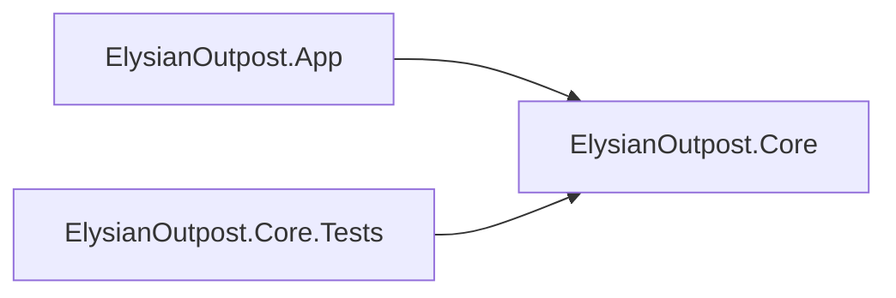

# Architecture

This document gives the projects of the .NET solution and the dependency rules of the core library. The tests apply the rules (#16).

## Projects

| Project | Folder | Purpose |
|---|---|---|
| `ElysianOutpost.Core` | `src/ElysianOutpost.Core/` | The core library. It will contain the game rules and the simulation. |
| `ElysianOutpost.App` | `src/ElysianOutpost.App/` | The app. It will use BRUTAL for the window, the input, the GPU and the debug UI. |
| `ElysianOutpost.Core.Tests` | `tests/ElysianOutpost.Core.Tests/` | The tests of the core library. |

The arrows show the project references:



The legacy Unity project is not in the repository anymore. The tag `unity-final` keeps it (#14).

## Dependency rules of the core library

The core library must not use windows, input or the GPU. Thus the CI can test it on runners without a GPU. Tools and benchmarks can also use it without the app.

1. The core library can reference only these BRUTAL packages directly:
   - `Ahwoo.BRUTAL.Core`
   - `Ahwoo.BRUTAL.Numerics`
   - `Ahwoo.BRUTAL.Maths`
   - `Ahwoo.BRUTAL.Memory`
   - `Ahwoo.BRUTAL.Collections`
   - `Ahwoo.BRUTAL.Concurrency`
   - `Ahwoo.BRUTAL.Logging`
2. The ID of a package of the core library must not contain any of these names, in any letter case: `Vulkan`, `OpenGL`, `GLFW`, `SDL`, `ImGui`. This rule applies to the direct dependencies and to the transitive dependencies.
3. The core library must not use the app (`ElysianOutpost.App`). The rule identifies a project by the name of its project file.

Rule 1 applies only to the direct dependencies. A package in the list of rule 1 can bring other BRUTAL packages as transitive dependencies. For example, `Ahwoo.BRUTAL.Logging` 2026.10.2 brings `Ahwoo.BRUTAL.Strings`. Rule 2 also applies to these packages.

For the packages that do not come from BRUTAL, rule 2 is the only rule. Rule 2 finds a package only by its ID. For example, it does not find `OpenTK.Graphics`, a package for OpenGL. Thus the review of a pull request must also look for other packages for the GPU, the window or the input.

## How the tests apply the rules

The test `DependencyRulesTests.CoreLibrary_FollowsTheDependencyRules` reads the assets file of the core library: `src/ElysianOutpost.Core/obj/project.assets.json`. The restore step writes this file.

The test fails if a dependency breaks a rule. The failure message gives the number of the rule, and the package or the project. Example:

```text
The core library breaks the dependency rules of docs/architecture.md:
Rule 1: ElysianOutpost.Core references Ahwoo.BRUTAL.Vulkan. It can reference only these BRUTAL packages: (...)
Rule 2: ElysianOutpost.Core uses Ahwoo.BRUTAL.Vulkan (direct dependency). The package ID contains "Vulkan".
```

To find the package that brings a transitive dependency, run this command in a terminal at the root of the repository:

```shell
dotnet nuget why src/ElysianOutpost.Core <package ID>
```

`dotnet test` runs the test. The CI (#11) runs it for each pull request.

The test reads the result of the last restore. After a change to a project file, do not use `dotnet test --no-restore`. Then the test reads an old assets file, and it can pass by mistake.

MSBuild also stops a circular project reference. The app references the core library. Thus a reference from the core library to the app stops the restore step.

## Change the rules

1. Give the reason for the change in the pull request. For a large change, write an ADR in `docs/adr/`.
2. Change this document and `tests/ElysianOutpost.Core.Tests/Architecture/DependencyRules.cs` in the same pull request.
